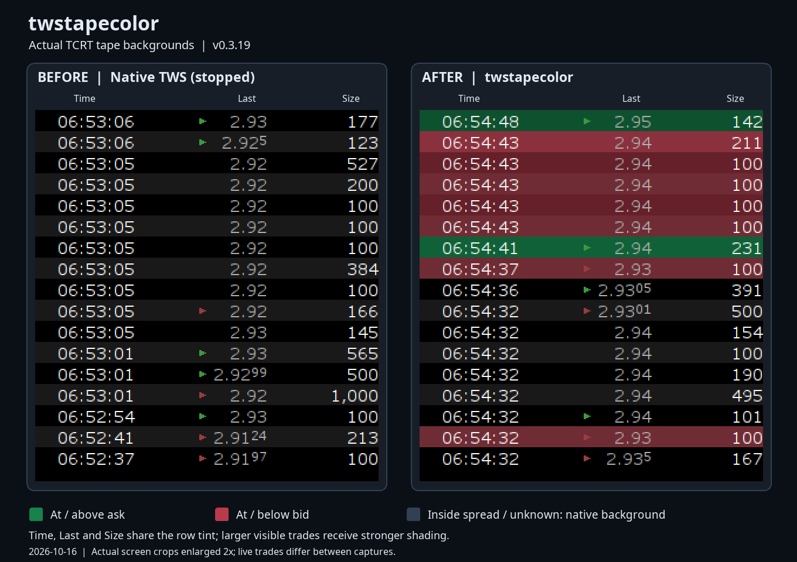

# twstapecolor v0.3.18

Experimental Time & Sales **row backgrounds** for Interactive Brokers Trader Workstation (TWS) on Linux. Unofficial; not affiliated with or supported by Interactive Brokers. It does not place orders or use account credentials.

## Before and after

Actual screen captures from TWS 10.51.1c on 2026-10-15, with only **Time, Last and Size** visible.



Green marks trades at or above the captured ask; red marks trades at or below the captured bid. Inside-spread and unknown trades keep their native background. Larger trades receive stronger shading across all three columns.

The tape was live, so these captures show different moments and different trades. The graphic uses the original tape-only captures, enlarged 2× without changing their pixels; the left image also verifies that `stop` restores the native appearance. This comparison records v0.3.14; v0.3.16 uses the brighter defaults and wider size shading described below.

## Behavior

- Show the newest **50 trades** available in the retained TWS event model, in model order (newest first). A trade requires both a positive numeric **Last** and **Last Size** (or **Size**). Empty, zero, nonnumeric and nonfinite values are hidden.
- Hide quote-only and incomplete rows **in the table view**. All events remain in the model. The tool cannot recover older trades that TWS has already dropped; increase TWS's event retention if fewer than 50 trades are retained.
- In TWS, capture the **latest observed top-of-book quote before each incoming trade is delivered to the tape**, then freeze that quote with the trade event. Quote updates are captured separately from displayed rows, so only Time, Last and Size need to be visible. A later quote cannot recolor an earlier trade. This follows local TWS delivery order, not a guarantee of exchange sequencing across separate quote/trade feeds.
- At or above the preceding ask: green (`#16834A`). At or below the preceding bid: red (`#B83B4B`). Inside the spread, missing quotes, and invalid, partial, locked or crossed quotes: original TWS appearance. Invalid quotes replace earlier valid quotes rather than silently reusing stale data.
- Tint every visible column. Smaller trades have softer backgrounds; the largest of the visible trades receives the configured color. Intensity is `0.18 + 0.82 * sqrt(size / largest visible size)`, blended with each renderer's original background. The scale updates as trades enter or leave the visible set. With a 10,000-share maximum, 100 / 1,000 / 10,000 shares use about 26% / 44% / 100% intensity, making large prints easier to distinguish.
- Preserve selected-cell appearance. `test-paint` uses alternating full-intensity colors solely for diagnosis.

This version replaces the old UP/DOWN renderer-tag classifier with captured bid/ask comparisons. It is a price-relative classification, not a verified identification of the trade aggressor.

### Supported data and view layout

Only `feature.tape.ui.aN` tables with `feature.tape.ui.aT` or `feature.tape.data.k` models are targeted. Native event access does not depend on displayed column names: `Last/Midpoint` and hidden/reordered columns work. The generic test adapter recognizes `Last`/`Last/Midpoint`, `Last Size`/`Size`, and Bid/Ask or NBBO columns. Model events must be newest first.

**Actual TWS data:** `getValueAt()` returns null in the tested models. The adapter reads `e(row, -1)` to obtain the native event, then `D()` for Last and `F()` for Last Size. It recognizes TWS's `Double.MAX_VALUE` missing-price sentinel. At the market-record notification boundary, it reads the existing top record's bid, ask, bid size and ask size; each new live trade is paired with that preceding snapshot before rendering. It does not create quote columns, change tape configuration, or request a new market-data subscription. The native accessors are specific to the tested TWS build and fail neutral if unavailable.

Trades already present when attaching, historical backfills, or events whose quote could not be captured remain neutral. Current quotes are never applied retroactively. Captured event state is bounded to 4,096 trade objects and 64 watched market records at a time; a newly encountered record replaces the oldest watched record when that bound is reached. Frozen quotes stay attached to retained trade events. `stop` releases captured state. Native table rendering receives the translated model row after filtering, because TWS renderers bypass the usual cell-value API.

The plain `TableModel` classifier used by synthetic tests still accepts numeric Bid/Ask columns or decimal NBBO pairs separated by `x`, `×`, `/`, or a spaced hyphen. These textual parsers are not used to guess values from native TWS renderer labels.

The native Current summary retains its original row handling and is never filtered. The history filter installs a private Swing row sorter only when the table has no existing sorter and either its native event accessor or ordinary trade columns are recognized. **An application-owned sorter is preserved; filtering and NBBO coloring are skipped for that table.** Unrecognized native accessors and unsupported ordinary table layouts are left unchanged. Use `probe`/`report` to inspect the actual TWS values if the tape remains unfiltered or neutral. Supporting additional TWS formats requires a captured example and a parser test.

### Renderer and instrumentation lifecycle

The agent retransforms three narrowly matched methods in JVM memory: the renderer selector in `jtable.basic.by`, the notification boundary in `jclient.record.o`, and the completed live-event factory in `feature.tape.data.a`. The exit hook loads the returned renderer and `this` only; it never reloads dead row/column arguments, preserving the fix for the original `VerifyError`. Existing stack-map frames are retained.

Renderer wrappers are bound to their owning tape table and recheck that owner before any data access or row translation. Wrappers are cached per view (at most 64 delegates), unwrapped before reuse elsewhere, and released when the view closes. Tinting replaces background fills through the paint call's graphics only; it never calls native `setBackground` or `setOpaque`, and never reparents a shared renderer. Native text and icons are forwarded unchanged. Temporary renderer bounds are restored in `finally`, including when painting fails. Classification uses captured quote/trade data and does not recursively render other cells. Native history row notifications rebuild the sorter from the current retained model, with a guard for newly grown rows during Swing repainting. This handles TWS symbol resets whose update/insert/delete ranges do not follow Swing incremental-sorter rules. Model changes mark classifications dirty. The first paint refreshes them from the current model immediately, avoiding a neutral-background flash while the deferred filter update is queued. Filter membership is reapplied only when the included model rows change. Native painting uses frozen per-trade quotes; it never reads a newer quote to recolor an older trade. Quote state updates at record notifications, and classification uses the cached quote associated with the trade.

`stop` disables and restores data hooks, removes model listeners and the private view filter, releases captured event state, then removes the renderer transformer and requests restoration of the original bytecode. Model replacement or loss of displayability discards the old view state, including listeners and cached renderers. A pending installation is canceled if its displayed table closes first. A later `start` installs fresh view state. The registering instrumentation handle is retained across commands; a failed transformer removal is reported as a warning instead of claiming restoration. View installation/removal preserves selection by model row. Stop waits for any in-flight data callback before clearing caches. Agent, data, view and hook classes have new versioned names to avoid reusing older classes already loaded in TWS.

## Build and run

Requirements: Linux, JDK **21+** (`java`, `javac`, `jar`, `jcmd`), Bash, and `unzip`. The build downloads ASM 9.8 from Maven Central if missing; subsequent builds can run offline.

```bash
./build.sh
./test.sh
./twstapecolor --version
jcmd -l
# Choose the correct TWS PID explicitly:
./twstapecolor start --pid 12345
./twstapecolor status --pid 12345
./twstapecolor stop --pid 12345
```

Before upgrading from an older running agent, **restart TWS completely** to clear stale hooks and renderers. Initially validate in paper trading. Versions through v0.3.15 could permanently disable backgrounds on shared native renderers, affecting Level 2. Stopping those versions cannot reliably recover that state; restart TWS once before upgrading. Change symbols, reorder/hide columns, scroll, and try `start`, `stop`, `start` while watching the tape. Confirm NBBO parsing and event order on your TWS build before trusting the display.

Custom colors (six-digit hex RGB):

```bash
./twstapecolor start --pid 12345 --ask-color '#006B3C' --bid-color '#8B2025'
```

The launcher attaches through a version-specific JAR path to avoid TWS reusing an old JAR index when upgrading in the same JVM. Each `start` resets unspecified colors to the defaults. Run `start` again to change them without restarting TWS.

## Switching symbols

Use TWS's normal linked symbol selectors. The tool follows the existing link configuration and does not change subscriptions or link groups. During contract lookup the history can briefly clear; new retained trades should then populate normally, with the native Current row still controlled by TWS. Each incoming trade uses its own instrument's captured quote. Reused trade objects cannot inherit a previous instrument's captured quote, and record-cache turnover does not stop quote capture after many switches.

v0.3.16 could throw a Swing sorter exception during a symbol reset, aborting the linked-window update and leaving Level 2 on the old symbol with an empty tape. v0.3.18 fixes the native row-event handling and stale repaint-index path. Restart TWS when upgrading from an older active agent, as described above. If a previous version has already stalled a switch, start from fresh native TWS and reselect the intended symbol before enabling the current version.

Repeated live 1810/9988 SEHK switches, empty/reset notification stress, new history arrivals and per-symbol color checks are documented in the [symbol-switch verification report](QA-REPORT-2026-10-16.md). The tested Hong Kong session had no depth subscription, so Level 2 contract/quote linkage was checked; live depth-book rows were unavailable.

## Diagnostics and debug opt-in

- `status --pid PID`: data-hook state, quote/trade counts, last captured bid/ask prices and sizes, last trade and its frozen quote/direction, data errors, renderer/color counters, and configured colors.
- `test-paint --pid PID`: alternating green/red diagnostic rows; unrelated to classification.
- `probe --pid PID`, then `report --pid PID`: bounded renderer metadata and values. Probe mode removes the trade filter and makes no color changes.
- `dump --pid PID`: deliberately saves in-memory target bytecode to a `.class` file.

Commands print to the console. Normal commands leave no persistent reports: a short-lived response file in `build/` is removed after use (a forcibly killed launcher may leave it behind). Add `--debug` to any command to retain `logs/twstapecolor-<command>-<pid>-<timestamp>.txt` inside the project. All persistent diagnostics, including requested bytecode dumps, stay in the project; `logs/`, `work/` and `*.log` are ignored by Git. Inspect diagnostic data before sharing; it may contain market data and symbol information. `dump` writes its requested file even without debug. The launcher rebuilds the agent JAR before each command.

## Validation and limits

v0.3.18 adds native symbol-reset handling, stale-index guards, an unfiltered Current summary, bounded watched-record turnover, and instrument/price/size guards on captured events. The suite includes 100 deterministic reset cycles, 1,000 seeded model/count/selection resets, and 256 distinct record changes under constrained heaps. See the [2026-10-16 report](QA-REPORT-2026-10-16.md) for live switch checks and limits.

v0.3.16 uses brighter defaults and a wider size-intensity range. It fixes Level 2 interference caused by restoring a context-dependent `isOpaque()` answer as a permanent native renderer setting. The new painter changes only its graphics, reuses wrappers and paint components, releases closed views, caches native field lookups, and rejects unrelated quote notifications without taking the feed callback lock. Native trade/record caches remain capped at 4,096 / 64. One million synthetic paints complete under a 64 MiB heap limit; live correctness, isolation and resource measurements are recorded in the [QA report](QA-REPORT-2026-10-15.md).

v0.3.15 fixed live-update background flicker: paints no longer see an empty classification cache between a model event and its queued rebuild, and unchanged filter membership no longer resets the sorter. The regression suite checks that immediate paints stay colored and changed trades receive fresh classifications. Size-dependent shading can still adjust when the largest visible trade changes.

v0.3.14 fixed five issues found during the deeper review: renderer-transformer ownership across separate attach commands, selection loss when adding/removing the filter, stale quotes after loss of the live top record, current-trade cache growth beyond its record limit, and an in-flight callback racing with stop. Failed-start rollback and failed-stop reporting also have regression coverage.

The v0.3.15 live update-gap check observed zero flashes in 18 directional row checks (the previous version flashed in all 33 baseline checks). A separate live audit matched 13 trades and 918 colored cell paints with zero mismatches; stop restored all 42 checked native properties and method fingerprints. See the [QA report](QA-REPORT-2026-10-15.md).

For opt-in reproducible live tests, see [tests/live](tests/live/README.md). Normal `./test.sh` does not attach to TWS.


`./test.sh` compiles the agent and runs headless Swing checks with `-Xverify:all`. Tests cover event ordering, absent/invalid/partial/locked/crossed NBBO, pair parsing, hidden columns, the 50-trade limit, bounded history reads, adaptive intensity, full-cell painting, shared-component restoration (also on exceptions), model updates/replacement, filter removal/restart, selected cells, and non-tape isolation. A synthetic target reproduces the dead row/column argument stack-map frame and loads and executes transformed bytecode. An instrumentation test double verifies transformer installation/removal across stop/start cycles.

**Live verification (2026-10-15, TWS 10.51.1c):** attached to the running TWS, confirmed null cell values and native event accessors, and verified live bid/ask prices and quote sizes. Observed both green ask-side and red bid-side full-row backgrounds in actual screen captures of the existing three-column tape, with variable intensity. Independent audits compared native quote/trade values and actual background pixels. The v0.3.14 audits matched all 27 live trades and 3,315 colored cells; the earlier baseline matched 93 trades and 2,280 colored cells. A further arrival-book check matched all five sampled quote-price and quote-size snapshots. Three repeated stop/start cycles restored all 42 compared table properties and normalized method fingerprints, with zero remaining agent calls in the three target methods. See the [expanded QA report](QA-REPORT-2026-10-15.md) for counts, fixes and limits. Raw diagnostic captures stay in local ignored directories; selected market-data-only captures are included under `docs/screenshots/`.

`./test.sh` also includes native-shaped null-cell model tests for frozen quote snapshots, instrument isolation, empty notification arrays, missing-value sentinels, historical neutrality, 50-trade limiting, stop cleanup and floating-point quote rounding. All 56,540 automated checks pass with `-Xverify:all`.

Other TWS versions remain untested. Native class names and accessor signatures may change. Retention remains controlled by TWS: in the tested layout its native history model contained 17 trade events, so the tool could show 17 retained trades, capped at 50. It does not manufacture missing history. The tape-only comparison above records v0.3.14. The [v0.3.16 verification report](QA-REPORT-2026-10-15.md) documents the current shades and Level 2 isolation.

For `VerifyError`, restoration failure, freezes or unexpected UI behavior, stop testing and restart TWS. Report TWS/Java versions and opt-in diagnostic output. If rows remain unfiltered, check required columns and the existing-sorter limitation. If rows are filtered but neutral, inspect `feedHooks`, `quoteEvents`, `tradeEvents`, and `dataErrors` in `status`. Newly captured trades require usable bid/ask data; older unobserved trades intentionally stay neutral.

## License and liability

Project code is free and open source under the [MIT License](LICENSE). Retain its copyright and license notice when redistributing. The MIT license and its warranty/liability disclaimer are unchanged.

Use at your own risk. An attached Java agent runs inside TWS and changes rendering in memory. Bugs or TWS updates may cause incorrect colors, UI freezes, crashes, missed information or trading losses. Installed TWS JARs, executables and configuration files are not overwritten. `stop` restores the bytecode on a best-effort basis; restarting TWS reliably clears runtime changes. Read the source and test in paper trading. Colors are not investment advice, verified executions, or a guarantee of trade direction.

ASM 9.8 is third-party software under BSD-3-Clause, separately from this project's MIT license. Its redistribution conditions apply to the bundled dependency; see the [ASM license](https://asm.ow2.io/license.html). No proprietary TWS class files are distributed; tests use synthetic fixtures.
