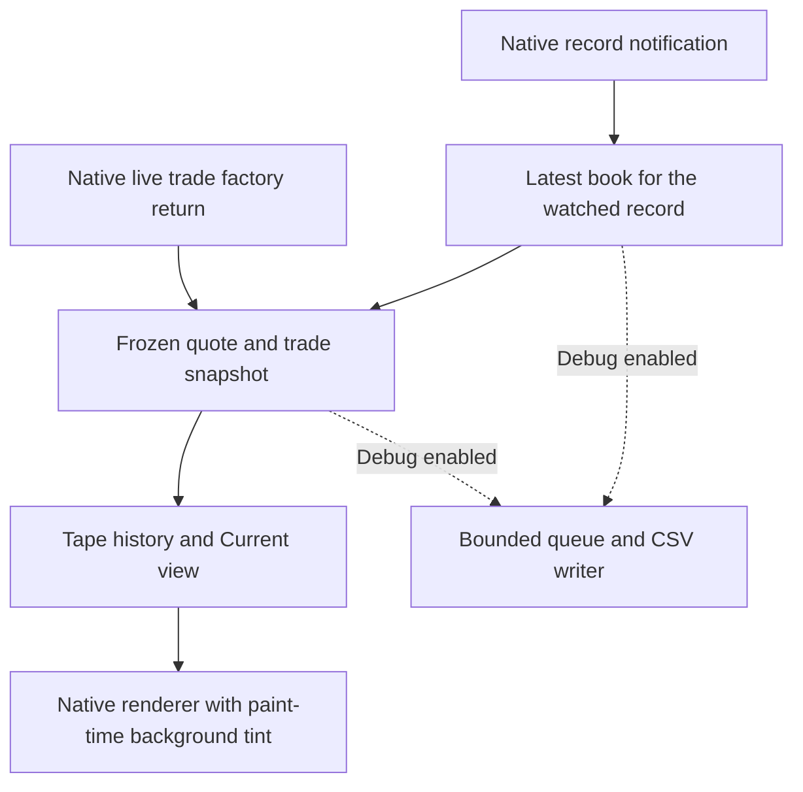

# Internals and maintenance

[Documentation index](README.md) · [Operations](user-guide.md) · [Diagnostics](diagnostics.md)

This guide describes the v0.3.24 implementation. Names from TWS are observations about the inspected build, not a supported Interactive Brokers API. Before changing a matcher or accessor, check the behavior against the intended TWS build and preserve the regression cases below.

## Process and code map

The same JAR serves as an external command-line program and an agent loaded into TWS. The launcher resolves the PID, loads the versioned JAR through Java Attach, then detaches its attach connection. The agent stays in TWS. The launcher reads its response file until `STATUS: COMPLETE`; the polling budget is 15 seconds after the attach call returns, not a deadline on the attach call itself. Errors in the agent can appear in the report with a stack trace.

| Code | Responsibility |
| --- | --- |
| [Main.java](../src/twstapecolor/Main.java) | Parse CLI options, discover TWS, attach, and read the command response. |
| [AgentV0324.java](../src/twstapecolor/AgentV0324.java) | Agent entry point, response-file protocol, live debug setup and error reporting. |
| [HookV0324.java](../src/twstapecolor/HookV0324.java) | Command modes, renderer hook, target checks, probe sampling, and restoration. |
| [FeedHookV0324.java](../src/twstapecolor/FeedHookV0324.java) | Install and remove the quote and live trade callbacks. |
| [LiveTapeDataV0324.java](../src/twstapecolor/LiveTapeDataV0324.java) | Read native objects and store instrument-scoped snapshots. |
| [TapeViewV0324.java](../src/twstapecolor/TapeViewV0324.java) | History membership, row mapping, classification snapshots, and view lifecycle. |
| [TintRendererV0324.java](../src/twstapecolor/TintRendererV0324.java) | Blend backgrounds during painting while delegating native content. |
| [DebugLogV0324.java](../src/twstapecolor/DebugLogV0324.java) | Bounded asynchronous CSV session. |
| [ColorTagDetector.java](../src/twstapecolor/ColorTagDetector.java) | Legacy renderer-tag logic retained for regression coverage; not the live price classifier. |



## What the agent instruments

| Loaded TWS class | Target and injection point |
| --- | --- |
| `jtable.basic.by` | `getCellRenderer(int,int): TableCellRenderer`. At each object return, pass the returned renderer and receiver into the wrapper. |
| `jclient.record.o` | `a(IRecObservable.Scope, IRecObservable.ObserverType, RecordChangeEnum[]): void`. Observe the record at method entry, before native observers run. |
| `feature.tape.data.a` | `a(feature.timesales.l): feature.tape.data.a`. Observe the returned event before it is handed to the caller. |

Transformers use ASM 9.8 and match the selected loaded class and method descriptor. The renderer hook preserves stack-map frames and computes maximum stack size. Do not reload the renderer's row and column arguments at a return site: TWS's stack map can mark those slots dead there, and doing so caused the original `VerifyError`. The renderer learns actual coordinates later, through Swing's normal callback. Retain the registering `Instrumentation` handle to remove each transformer; later CLI commands can receive a different handle.

The agent mutates bytecode in the JVM, not the installed application files. The renderer target can be a shared Swing class, so the wrapper must also enforce the exact tape table/model types at runtime. A missing renderer target prevents installation. If either native feed class is not loaded, the feed installer returns without enabling the hooks; check `feedHooks` instead of interpreting paint alone as data support. A matching loaded class with an unexpected descriptor can fail installation. Preserve clear errors and rollback when modifying these paths.

## Native access and state

- The supported tape table is `feature.tape.ui.aN`. The history model is `feature.tape.ui.aT`; the separate Current model is `feature.tape.data.k`.
- Read a native event through `e(row, -1)`, price via `D()`, size via `F()`, and the instrument's record via `ar().rk()` (10.51) or `ar().q6()` (10.52) or `ar().q8()` (10.53), with the return type checked. Native `getValueAt()` can return null despite a populated cell. The adapter converts missing, nonpositive or nonfinite numbers to unavailable and rejects `Double.MAX_VALUE`.
- Read the record's existing top object through field `p` and its book through `cO(): aZ` (10.51) or `cN(): a0` (10.52) or `cO(): a0` on `jclient.oQ` (10.53). The book methods are `G()` for bid, `F()` for ask, `aa()` for bid size and `Z()` for ask size. Never use the absence of entries in a notification's changes array as proof that no book fields changed.
- Watch records and cache captures by object identity. Seed the book when a record is first seen, but do not assign it to pre-existing rows. A captured history event must match record identity, price and size. Current events of the expected class can use the latest matching capture for their record and price/size.
- The watched-record cache holds 64 entries and evicts in insertion order; eviction also drops that record's Current capture. The event cache holds 4,096 entries, retaining frozen quotes independently of watched-record turnover. Unrelated record notifications are rejected by an immutable watched-set snapshot before the callback lock. Available books with identical price and size fields are deduplicated.

The ordinary `TableModel` path used by fixtures reads numeric Last/Size and Bid/Ask or a decimal NBBO pair. It walks relevant newest-first model rows in reverse to find the quote that precedes each print; a quote on the trade's own row does not precede that trade. This is a test and compatibility path for recognized model columns, not a parser for arbitrary native TWS renderer labels.

## View and renderer invariants

The event-dispatch thread owns each tape view. Do not replace an application-owned sorter. The private history sorter filters rows without enabling column sorts, so native model order is preserved. Native renderer calls need the translated **model** row because the renderer fetches the event by index. Current does not get a private sorter.

TWS can reuse the history model and emit update ranges that do not follow the default Swing sorter's incremental contract. The native adapter rebuilds mappings from the actual model on notifications and treats rows without a current mapping as hidden. This prevents invalid ranges from aborting TWS's linked-window callback chain. A data change marks the classification snapshot dirty. Paint can refresh it immediately, while filter updates run separately and only change membership when needed. Do not clear the snapshot and leave a gap that renders fresh directional rows neutral.

The wrapper verifies ownership before translating rows or tinting, even when a delegate is shared or cached across views. Each view caches at most 64 delegate wrappers. The painter redirects background fills on a graphics copy, delegates native text/icon drawing, and restores temporary bounds in `finally`. It does not reparent the native component or set its background or opacity. The old opacity-based approach could permanently change a shared renderer and leave Level 2 without its colors. Test a **populated** depth panel when validating this boundary.

Model/sorter replacement and loss of displayability discard view listeners, private filters, and cached wrappers. Selection is translated through model indices when the filter is installed or removed; a filtered-out row cannot remain selected. Stop disables rendering, stops feed callbacks before clearing event caches, restores views on the Swing thread, closes debug capture, and removes/retransforms the renderer hook. Restoration is best effort. Treat warnings as a reason to restart TWS and investigate, not as proof of successful cleanup.

## Verification workflow

Run the following from the repository root. The Java suite builds the agent and runs headless with bytecode verification; it does not attach to TWS. Some suites constrain the heap to exercise bounds. The Python tests validate the saved-trace verifier independently.

```bash
./test.sh
python3 -m unittest discover -s tests -p 'test_*.py'
```

| Change area | Evidence to collect |
| --- | --- |
| CLI discovery and parsing | Zero, one and multiple TWS matches; unrelated JVM and IB Gateway exclusion; PID override and error/exit paths. |
| Instrumentation | Verified transformed bytes for dead argument slots, successful install and stop, failed-start rollback and restoration warnings. |
| Quote and trade capture | Instrument identity across switches, invalid/locked/crossed books, quote sizes, cache turnover, frozen event direction and callback/stop ordering. |
| Tape and tint | Retention/filter rules, Current preservation, native reset ranges, view-to-model selection and delegate mapping, repaint gap, size blending and selected cells. |
| Logging | Disabled writes, capture ordering, queue and disk bounds, rotation, worker cleanup, and verifier detection of incomplete or corrupted traces. |
| Live compatibility | Fresh history on linked switches, real bid/ask values and colored cell pixels, populated Level 2 isolation, and native state restored by stop. |

The [live audit guide](../tests/live/README.md) gives the attach commands and sample outputs for accuracy, update-gap, Level 2, symbol-switch, restoration and resource audits. Run a clean native baseline, test with the exact build intended for distribution, then compare after stop. An unchanged but empty depth pane is inconclusive. Separate ordinary-operation resource samples from costly paint/source audits; process CPU and heap include all of TWS.

The [October 15 report](../QA-REPORT-2026-10-15.md) documents the tested TWS 10.51.1c path and renderer regression work. The [Hong Kong report](../QA-REPORT-2026-10-16.md) documents linked-symbol testing without subscribed depth rows. The [US premarket report](../QA-US-2026-10-16.md) records 148 audited trade callbacks, 7,269 colored cell paints, populated depth checks and three restoration cycles on v0.3.19. These are dated observations, not guarantees for other builds, platforms or market feeds. Current packaging and launcher checks are in [LIVE-VERIFICATION.md](../LIVE-VERIFICATION.md).

## Build and package a release

1. Make source and regression changes together. When releasing changed runtime helpers, update their versioned class names consistently across source references, injected bytecode owners, manifest and diagnostics. A running TWS JVM can reuse a helper class already loaded with the same name. Restart TWS for a clean upgrade test.
2. Run the headless suites. If touching attachment, feeds, rendering or lifecycle, run the relevant live audits as well. Record exact version, platform, target TWS build, symbols, sample counts and limits.
3. Build the shared artifact with `bash tools/package.sh`. It builds into ignored `out/`, reads the tool version, copies the corresponding version-named JAR into `dist/`, and writes `dist/SHA256SUMS`. Normal builds do not update the committed JAR. Avoid concurrent builds and tests in one checkout because they share generated paths.
4. When the version changes, update both active README instructions and the Windows start script's JAR filename. Keep the start/stop scripts next to the versioned JAR. Confirm the package includes the application and agent manifest entries, ASM, and the MIT and ASM license texts. Include no native TWS binaries or captured classes.
5. Smoke-test the distribution with the intended JDK. Verify the checksum from inside `dist/` and try the Windows scripts on Windows before making any Windows support claim. Stage the artifact, checksum and updated instructions together. Keep raw logs, captures and audit binaries out of the commit.

```bash
bash tools/package.sh
(cd dist && sha256sum -c SHA256SUMS)
java -Xverify:all --add-modules jdk.attach -jar dist/twstapecolor-v0.3.24.jar --version
```

The project is [MIT licensed](../LICENSE); bundled ASM has a [separate BSD-3-Clause license](../third-party/ASM-LICENSE.txt). Historical files can refer to prior JAR names, helper versions and build directories. Use the current guide for current commands; preserve dated reports as evidence.

### TWS 10.52 accessor compatibility (v0.3.21)

The installed 10.52 archive renamed `jclient.dA.rk(): jclient.record.o` to
`q6(): jclient.record.o`; `rk()` now returns a String. The existing top record's
`cO(): jclient.record.aZ` moved to `cN(): jclient.record.a0`; the new `cO()`
returns a different quote view. Resolve only these known name/return-type pairs,
cache them per class, and fail neutral on unsupported signatures. Do not select
other record getters that may create subscriptions. `Tws1052Test` reproduces both
name collisions; `LiveDataTest` retains coverage of the previous adapter.

The 10.52 installed bytecode was inspected for both data hooks and the renderer
hook. Live attachment/rendering still requires a running TWS session.

### TWS 10.53 accessor compatibility (v0.3.22)

Inspected the locally installed TWS 10.53.1a archive (build November 20, 2026),
selected by the November 26 startup log. The instrument class changed from
`jclient.dA` to `jclient.dz`; the existing-record getter is now `q8(): jclient.record.o`.
`q6()` now returns String, and `rk()` returns an unrelated execution object.
The record's `p` field now holds `jclient.oQ`, whose `cO(): jclient.record.a0`
returns the book; `cN()` now returns boolean. Match the top class, getter name
and return type explicitly, and reject unrecognized native top classes.

All three instrumentation target signatures, tape table/model names, inherited
`e(int,int)` row access, `D()`/`F()` trade access and `G()`/`F()`/`aa()`/`Z()`
book signatures remain present. The existing-record `q8()` is a field read;
do not use the separate `st()` getter, which can allocate another record.
`Tws1053Test` checks historical neutrality, ask/bid coloring, frozen quotes and
name collisions; earlier-version regression tests remain in the suite.

Runtime helper classes were versioned V0322 to avoid reusing V0321 classes in
TWS. Restart TWS before upgrading. Live attachment/rendering on 10.53 could
not be checked from the process-isolated environment; static inspection and
headless tests do not establish live feed or rendering correctness.

### Automatic discovery (v0.3.24)

See [automatic discovery](automatic-discovery.md) for the implementation plan,
matching rules, static archive checker and limits. NativeResolverV0324 caches
resolutions by Class identity; MethodShapeV0324 provides instruction fingerprints.
Feed hooks now select a unique method by descriptor and staticness instead of
requiring the obfuscated name `a`. The descriptor and class anchors above remain
required. Record access is now a verified pure field read, not a name allowlist.
The new optional accuracy audit shares accessor discovery with production while
independently reading values and calculating quote/price/pixel comparisons.
